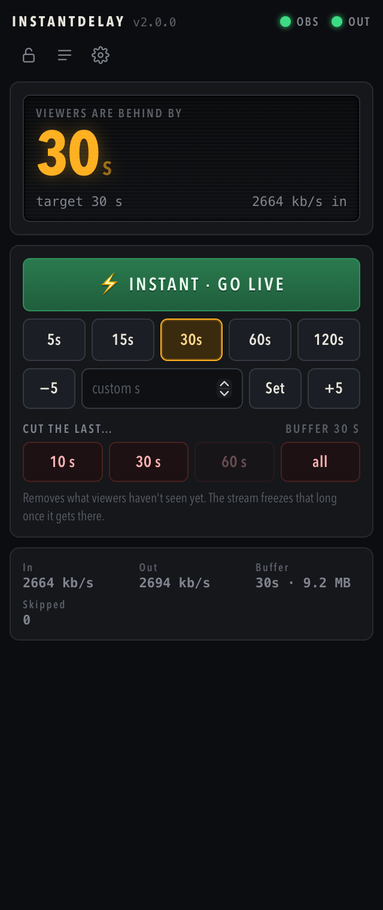
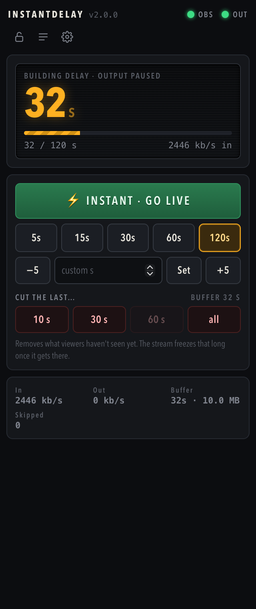

# InstantDelay

**Change your stream delay mid-stream, without restarting OBS.** Jump back to live with one click, cut out the last 30 seconds before viewers see them, and keep it all off the encoder.

OBS streams to InstantDelay on your own PC. InstantDelay holds the encoded video in memory and forwards it to Twitch (or YouTube, Kick, any RTMP ingest) with whatever delay you pick. Change it any time from an OBS dock, a Stream Deck button or a URL.

```
OBS ──RTMP──▶ InstantDelay (your PC, holds the buffer) ──RTMP──▶ Twitch
                       ▲
       OBS dock · overlay · Stream Deck · curl
```

<p align="center"> </p>

- **Lowering the delay** (⚡ Instant) skips forward to the next keyframe. Viewers see a clean cut back to live.
- **Raising the delay** applies **at once**: InstantDelay keeps the last minute of what already went out and sends it again, so viewers see the last N seconds a second time (a rewind) and the stream carries on N seconds behind live. No pause, no screen, no "building". Prefer the classic way? Set *When the delay goes up* to **Delay screen** in Settings: viewers see a picture while the buffer fills (0 → 60 s = 60 s of the screen). The built-in screen says *"Stream delay is building"*; upload your own PNG. Twitch keeps the stream online the whole time either way.
- **Cut** throws away the newest N seconds of the buffer, the part viewers haven't seen yet. The delay stays; when the output reaches the hole viewers see the delay screen that long.
- **Save a clip** of the last 30 s / 60 s / 2 min straight from the buffer, as an `.flv`, with zero extra CPU. Optionally **record** every broadcast exactly as the ingest received it.
- **Delay follows your OBS scene** (optional, via obs-websocket): *Gameplay* → 30 s, *Just Chatting* → live.
- Backup ingest, Twitch bandwidth-test mode, Discord/Slack alerts when something drops.
- Video and audio are **never re-encoded**. CPU use is close to zero; memory is bitrate × (delay + replay window) (6 Mbps × 120 s ≈ 90 MB). The delay screen is the one exception: a tiny built-in H.264 encoder draws it once per stream (~20 KB, ~150 ms).
- **No dependencies.** One Node.js process that speaks RTMP itself. No ffmpeg, no npm install, no build step.

## Setup on Windows (about 3 minutes)

1. Download the latest zip from **Releases**, unzip it somewhere permanent (e.g. `Documents\InstantDelay`).
2. **Double-click `start.bat`.** The first time it installs Node.js (via `winget`, built into Windows 11; say *Yes* if Windows asks) and asks for your **Twitch stream key**: [dashboard.twitch.tv](https://dashboard.twitch.tv) → Settings → Stream → *Primary Stream key* → Copy. Right-click pastes it; it stays hidden while you type. For YouTube/Kick paste the full `rtmp://…/key` URL instead.
3. **Point OBS at InstantDelay** (one-time): OBS → **Settings → Stream**
   - Service: **Custom…**
   - Server: `rtmp://127.0.0.1:1935/live`
   - Stream Key: `stream`
   - *Use authentication*: off
4. **Recommended OBS settings:**
   - **Settings → Output → Keyframe Interval: 2** (Twitch wants this anyway; it makes delay jumps clean).
   - **Settings → Advanced → Stream Delay: off.** InstantDelay does the delay now.
5. **Add the dock:** OBS → **Docks → Custom Browser Docks…** → Name `InstantDelay`, URL `http://127.0.0.1:8787/dock`.

**Every stream from now on:** double-click `start.bat`, then *Start Streaming* in OBS as usual. Leave the black InstantDelay window open (minimized is fine). When you stop streaming, the Twitch stream ends once the buffer has played out, plus 30 s in case OBS is just reconnecting.

macOS / Linux: install [Node.js 18+](https://nodejs.org) and run `./start.sh`.

### The dock

| | |
|---|---|
| **Readout** | How far behind viewers are *right now*. Amber = delayed, green = live. A **Replay** tag means viewers are watching the rewound seconds (with the time left); a **Delay screen** tag means they are looking at the screen; while a delay builds in screen mode it shows the progress bar. |
| **OBS / OUT lamps** | Green: data flowing. Solid amber OUT: the delay screen is being sent. Blinking amber: connecting. Red: not connected. |
| **⚡ Instant** | Delay 0, jump to live. |
| **Presets / −5 / +5 / custom** | Set the delay. Edit the presets in Settings. |
| **Cut the last…** | Tap once to arm (red), tap again within 3 s to cut. Buttons are disabled when the buffer is shorter than that. |
| **Save a clip of the last…** | One tap writes an `.flv` of the last 30 s / 60 s / 2 min of what OBS sent to the `clips/` folder (plays in VLC; drop it into any editor). |
| **🔒** | Lock the controls against misclicks. |
| **≡ Log** | What the InstantDelay window says, in the dock. |
| **⚙ Settings** | Stream key, presets, what happens when the delay goes up (rewind or delay screen), delay screen (with a *Preview to viewers* button), clips & recording, backup ingest, alerts, OBS scene rules, advanced options. Saved to `config.json`. |

Keyboard (when the dock has focus): `1`–`9` presets, `0` instant, `Esc` disarm a cut.

### On-stream badge (optional)

Add a **Browser Source** with URL `http://127.0.0.1:8787/overlay` to show a LIVE / DELAY badge on stream.


Options: `?hideLive=1` only shows it while there is a delay · `?pos=tr` corner (`tl` `tr` `bl` `br`) · `?size=28` font size · `?label=Delay` · `?bare=1` no box.

### Stream Deck (optional)

Use Stream Deck's built-in **System → Website** action and tick **"GET request in background"**:

| URL | What it does |
|---|---|
| `http://127.0.0.1:8787/api/instant` | Delay 0, jump to live |
| `http://127.0.0.1:8787/api/delay?sec=30` | Set delay to 30 s |
| `http://127.0.0.1:8787/api/delay?add=5` / `add=-5` | Nudge the delay |
| `http://127.0.0.1:8787/api/toggle?sec=30` | Toggle between live and 30 s |
| `http://127.0.0.1:8787/api/cut?sec=30` | Cut the last 30 s (no confirmation!) |
| `http://127.0.0.1:8787/api/clip?sec=60` | Save a clip of the last 60 s |
| `http://127.0.0.1:8787/api/screen/preview?sec=5` | Show viewers the delay screen for 5 s (a rehearsal; skips 5 s) |
| `http://127.0.0.1:8787/api/status` | Status as JSON |

Invalid values (`sec=3o`) are rejected and leave the delay unchanged.

## Troubleshooting

| Problem | Fix |
|---|---|
| Dock says **"InstantDelay is not running"** | Start `start.bat`. The dock reconnects by itself. |
| Dock says **"No stream key yet"** | ⚙ Settings → paste the key → Save. |
| **OBS** lamp stays red after *Start Streaming* | OBS → Settings → Stream must match step 3 exactly. |
| **OUT** lamp stays red / "Retrying in …" | Wrong stream key or no internet. Open ≡ Log for the reason. It retries automatically with backoff. |
| "port … is already in use" | InstantDelay is probably already open in another window. Close it. |
| Twitch "Enhanced Broadcasting" | Not available with a Custom server. Turn it off. |
| Node.js installed but `start.bat` still can't find it | Close the window and double-click `start.bat` again (a new window picks up the new PATH). |

The stream key is never printed (it shows as `****`), but it is stored in plain text in `config.json`. Don't share that file.

## Settings (`config.json`)

Everything here can be edited in the dock (⚙). Keys marked ↻ need a restart.

| Key | Default | Meaning |
|---|---|---|
| `outputUrl` | — | Where to send the stream. Any `rtmp://` or `rtmps://` URL (Twitch, YouTube, Kick…). Default Twitch URL auto-picks a nearby ingest; to choose one yourself see [Twitch's ingest list](https://help.twitch.tv/s/twitch-ingest-recommendation). A file path writes an `.flv` instead. |
| `presetsSec` | `[0,5,15,30,60,120]` | Buttons in the dock. |
| `maxDelaySec` | `300` | Largest delay allowed. |
| `maxBufferMB` | `1024` | Memory cap for the buffer. If the delay would need more, content is released early. |
| `initialDelaySec` | `0` | Delay when the app starts. |
| `endAfterIdleSec` | `30` | End the broadcast this long after OBS stops (0 = keep it open). |
| `raiseMode` | `rewind` | What happens when the delay goes up. `rewind`: the last N seconds are sent again and the new delay applies at once. `screen`: the output pauses and viewers see the delay screen while the buffer fills. |
| `rewindSec` | `60` | How far back a rewind can reach (the replay window kept in memory, shared with clips). A raise bigger than this shows the delay screen for the difference first, then the replay. |
| `delayScreen` | `default` | What viewers get while the output has to pause (cut hole, OBS gone, screen-mode raise): `default` (built-in screen), a `.png` path (your own picture; the dock uploads to `screens/custom.png`), `freeze` (repeat the last frame) or `off` (send nothing; Twitch drops the stream after ~30 s). |
| `clipSec` / `clipDir` | `60` / `clips` | Keep the last N seconds for *Save a clip* (0 = off; costs bitrate × N of memory) and where clips go. |
| `recordDir` | `""` | Folder for a recording of every broadcast, exactly as sent to the ingest (`.flv`, no extra CPU). Empty = off. |
| `outputUrlBackup` | `""` | Second ingest, used after two failed connections to the main one (alternating). |
| `bandwidthTest` | `false` | Adds `?bandwidthtest=true` to Twitch URLs: the ingest accepts the stream but the channel stays offline. For testing. |
| `webhookUrl` | `""` | Discord / Slack / any HTTP endpoint: output dropped or back, OBS gone or back, delay changed, bitrate collapse, clip saved. |
| `obsWsUrl` / `obsWsPassword` | `""` | obs-websocket (OBS 28+, Tools → WebSocket Server Settings). Needs Node.js 22+. Empty URL = off. |
| `sceneDelays` | `{}` | `{"Gameplay": 30, "Just Chatting": 0}`: the delay to apply when OBS switches to that scene. Scenes not listed leave the delay alone. |
| `rtmpHost` ↻ | `127.0.0.1` | `0.0.0.0` for a two-PC setup where OBS runs on another computer (Windows Firewall will ask). |
| `ingestKey` ↻ | `""` | If set, OBS must use this stream key. Empty = accept any. Set it when using `0.0.0.0`. |
| `rtmpPort` ↻ / `httpPort` ↻ | `1935` / `8787` | Ports for OBS and for the dock/API. |
| `transport` ↻ | `native` | `ffmpeg` uses ffmpeg for RTMP instead of the built-in code (v1 behaviour; needs ffmpeg installed). |
| `ffmpegPath` ↻ | `ffmpeg` | Only for `transport: ffmpeg`; file-only (not editable from the dock). Use forward slashes: `C:/ffmpeg/bin/ffmpeg.exe`. |

Environment variables override the file: `OUTPUT_URL`, `RTMP_PORT`, `HTTP_PORT`, `END_AFTER_IDLE_SEC`, `TRANSPORT`, `INSTANTDELAY_CONFIG` (path of the config file).

## HTTP API

All on `http://127.0.0.1:8787`. Only reachable from this PC; cross-site browser requests are refused.

| Route | |
|---|---|
| `GET /api/status` | Engine + connection status (JSON). Also pushed every 250 ms on `GET /api/events` (Server-Sent Events). |
| `GET /api/delay?sec=N` · `?add=±N` | Set / nudge the delay. |
| `GET /api/instant` | Delay 0. |
| `GET /api/toggle?sec=N` | Live ↔ N seconds. |
| `GET /api/cut?sec=N` | Drop the newest N seconds of the buffer. Returns `removedMs`. |
| `GET /api/clip?sec=N` | Write the last N seconds (replay window + buffer) to `clips/<timestamp>.flv`. Returns `file`, `ms`, `bytes`. |
| `GET /api/screen/preview?sec=N` | Show the delay screen to viewers for N seconds (skips that much content). |
| `GET /api/screen.png` · `POST /api/screen` | The current delay screen picture · upload a PNG (raw body) as the custom screen. |
| `GET /api/scenes` | OBS scene list and current scene (when obs-websocket is configured). |
| `GET /api/config` | Settings without secrets (`outputMasked`, `outputBackupMasked`, `obsWsPasswordSet`). |
| `POST /api/config` | JSON body with any settings keys except `ffmpegPath`, plus `streamKey` / `backupKey` (a key or a full URL). Returns `restartRequired: [...]`. |
| `GET /api/log?since=SEQ` | Recent log lines. |

## Known limits

- A rewind starts on the keyframe at or before the N-seconds mark, so viewers get up to one keyframe interval (2 s) more replay than asked; the stream never skips anything. Rewinds need the content to still be in memory: right after going live there is less than `rewindSec` to rewind into, and the delay screen covers the rest.
- When the stream resumes after a delay screen it restarts on OBS's next keyframe, so up to one keyframe interval (2 s with the recommended settings) of content is skipped. Pauses shorter than 1.5 s get no screen at all.
- The delay screen is drawn for H.264 4:2:0 8-bit progressive streams (what OBS sends to Twitch). For HEVC/AV1, 10-bit or interlaced video it falls back to repeating the last keyframe (`freeze`); audio silence is generated for AAC mono/stereo.
- If OBS stops and restarts within `endAfterIdleSec`, one continuous broadcast is kept (viewers see the delay screen in between). Changing encoder settings in between works (codec headers are re-sent), but some players need a moment to catch up.
- Enhanced RTMP (HEVC/AV1 from OBS 29+) packets are passed through untouched; tested with H.264/AAC.
- OBS scene rules need Node.js 22 or newer (built-in WebSocket client); everything else runs on Node.js 18.

## For developers

Node.js 18+. No npm packages. ffmpeg + ffprobe are only needed for the end-to-end tests.

```bash
cp config.example.json config.json   # or: npm run setup
npm start
npm run test:unit    # delay engine, hold/delay screen, H.264 encoder (bit-exact vs ffmpeg), PNG, RTMP chunk/AMF0, obs-websocket
npm run test:rtmp    # native ingest/publish against ffmpeg
npm test             # everything, incl. e2e in 3 modes (file output, RTMP output, ffmpeg transport)
```

The delay screen is produced by `src/h264.js`, a ~600-line intra-only H.264 encoder (Intra 16x16 + CAVLC, plus 10-byte "all skipped" P frames) that borrows the stream's own SPS, so it never has to re-encode anything else. `test/h264.test.js` checks it bit-exact against ffmpeg's decoder for Baseline/Main/High streams and splices it into real x264 output.

How it works, in `docs/ARCHITECTURE.md`. What's next, in `docs/IDEAS.md`. Contributions welcome: `CONTRIBUTING.md`.

## License

MIT.
